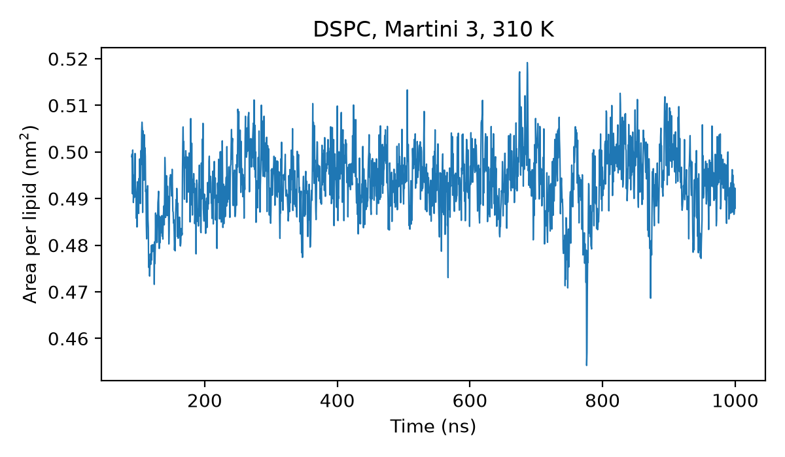
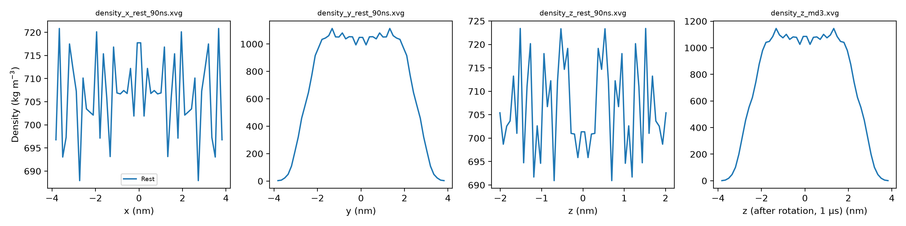

# Self-assembly of a DSPC bilayer (Martini 3)

Coarse-grained simulation of 128 DSPC lipids in water assembling into a bilayer from a random start. The setup follows the Martini 3 lipid bilayer tutorial (self-assembly, part I). I used it to learn coarse-grained simulation, then fixed an orientation problem the tutorial does not cover and extended the run to 1 µs.

## Setup

| Item | Value |
| --- | --- |
| System | 128 DSPC + 768 W beads (Martini water, about 3,000 water molecules) |
| Force field | Martini 3.0.0 (`martini_v3.0.0.itp`, `_ffbonded_v2`, `_phospholipids_PC_v2`, `_solvents_v1`) |
| Start | lipids placed at random (`128_noW.gro`), then solvated (`waterbox.gro`) |
| Time step | 20 fs |
| Temperature | v-rescale, 310 K |
| Pressure | semi-isotropic, 1 bar, τp = 11 ps, compressibility 3 × 10⁻⁴ bar⁻¹ |
| Length | 0–90 ns self-assembly, then 90 ns–1 µs continuation |

## What happened

1. **Self-assembly (0–90 ns).** The lipids formed a bilayer within 90 ns. The density profiles along x, y and z (`results/density_*_rest_90ns.xvg`) show it formed with its normal along **y**.
2. **Orientation fix.** Semi-isotropic pressure coupling treats **z** as the bilayer normal and scales x and y together as the membrane plane. With the normal along y, the coupling was mixing the membrane plane with the normal direction. I wrote `inputs/rotate_y_to_z.py`, which relabels coordinates and box vectors (x, y, z) → (z, x, y) so the normal lies along z, giving `inputs/dspc-rot.gro`.
3. **Continuation to 1 µs.** I rebuilt the run input from the rotated structure (velocities carried in the `.gro` file, no checkpoint) and continued from 90 ns to 1 µs (`tinit = 90000`, `nsteps = 45500000` in `inputs/martini_md.mdp`). The density profile along z after the rotation (`results/density_z_md3.xvg`) shows the expected slab.

## Results

| Quantity | Value |
| --- | --- |
| Area per lipid (mean over the second half of the 90 ns–1 µs run) | 0.494 nm² |
| Mean temperature | 309.6 K |

Area per lipid is Box-X × Box-Y / 64 (64 lipids per leaflet). 0.49 nm² is much smaller than a fluid bilayer (around 0.6 nm²), which points to an ordered, gel-like bilayer. That is what DSPC should do at 310 K, below its main phase transition at about 55 °C (328 K).

## Files

| Path | Contents |
| --- | --- |
| `inputs/` | starting structures, topology, Martini 3 force-field files, `minimization.mdp`, `martini_md.mdp` (continuation settings; the first 90 ns used the same file with `tinit = 0`), rotation script and rotated structure |
| `results/` | final structure (`dspc-md3.gro`), box, temperature and density `.xvg` files, `plot_results.py` and the figures it makes |

Trajectories and checkpoints are not included because of their size.

## Changes from the tutorial

- Rotated the self-assembled bilayer so its normal matches the semi-isotropic coupling axis (z), instead of leaving it along y.
- Extended the run from 90 ns to 1 µs and measured the area per lipid over the long run.
